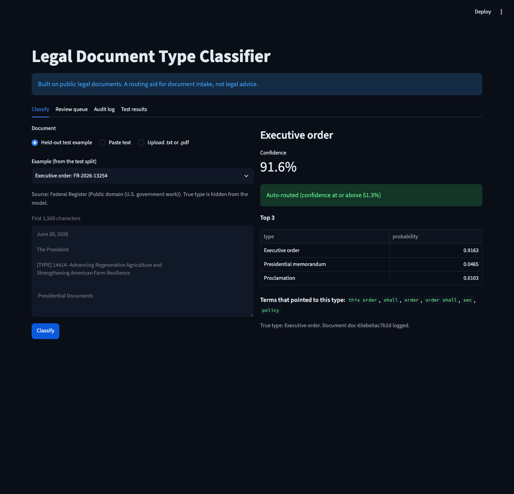
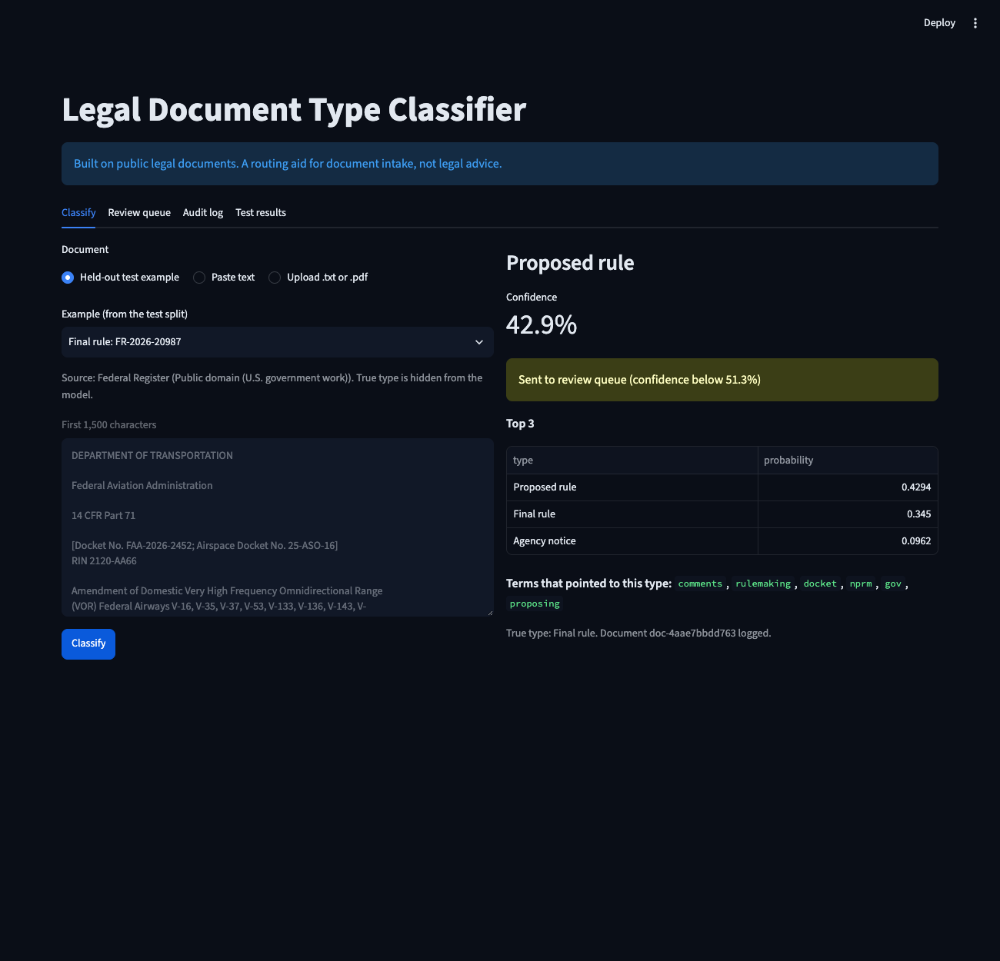
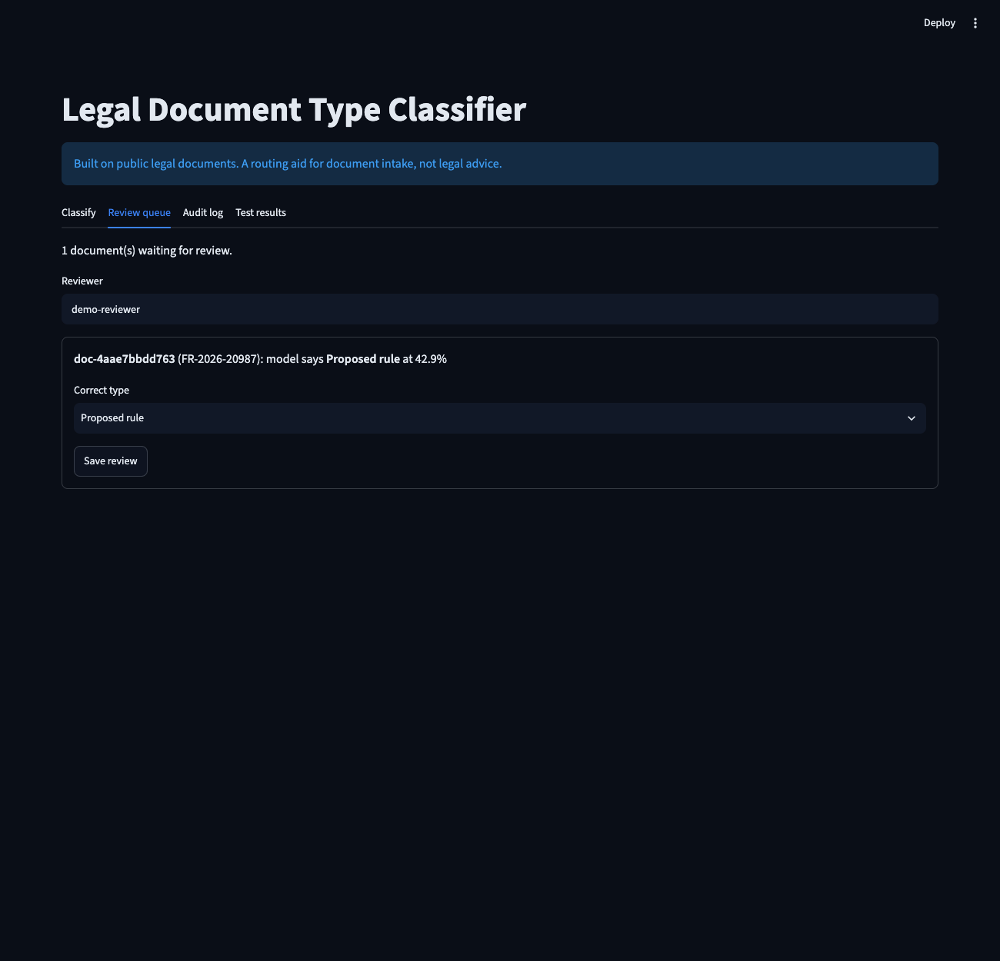
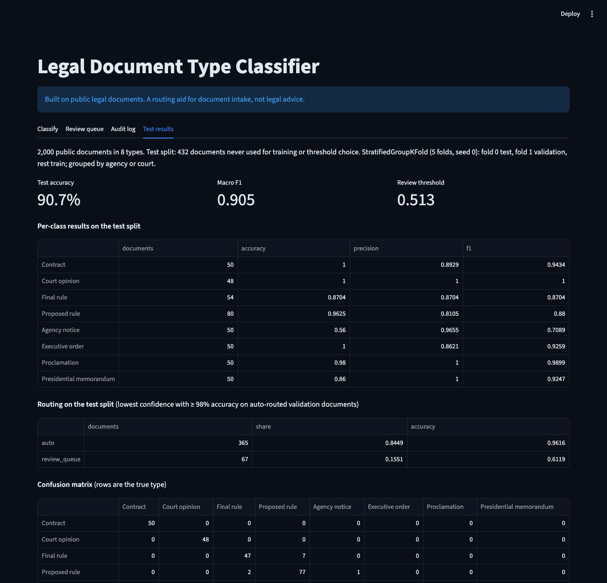
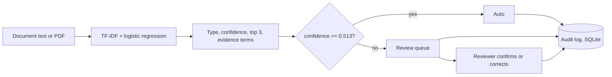

# Legal Document Type Classifier


**Status: In progress.** The classifier, review queue, audit log and Streamlit app run locally today.
There is no hosted demo of this version.

Independent reference project by Shoot It Analytics LLC. Built with public or synthetic data.

## What it does

1. Reads a legal document (pasted text, a .txt file or a .pdf) and predicts its type out of 8:
   contract, court opinion, final rule, proposed rule, agency notice, executive order, proclamation,
   presidential memorandum.
2. Gives the prediction a confidence score and the three most likely types, and lists the words in
   the document that pushed it toward the predicted type.
3. Routes confident predictions to **auto** and low-confidence ones to a **review queue**, where a
   person confirms or corrects the type.
4. Logs every classification and every review to an append-only audit log. The log stores a SHA-256
   hash of the text, not the text itself.

| Auto-routed | Sent to review |
|---|---|
|  |  |

| Review queue | Test results |
|---|---|
|  |  |

## Why I built this

**The problem.** Legal and compliance teams receive a steady mix of documents: contracts, court
decisions, agency rules and notices, presidential actions. Before anyone can analyze a document it
has to be sorted to the right person, and sorting by hand is slow. An automatic sorter is only useful
if it says when it is unsure, so uncertain documents still reach a person.

**What I set out to prove.** Whether a small, cheap classifier trained on public documents can sort
legal documents by type and, using its own confidence, separate the ones it gets right from the ones
a person should check, measured on documents from agencies and courts it never saw in training.

**Key design decisions**
- **Data:** 2,000 public documents, 250 per type, from the Federal Register API (public domain),
  the Caselaw Access Project (public domain) and the CUAD contract set (CC BY 4.0).
- **No giveaways:** Federal Register text states its own type (section banners such as
  "[Proposed Rules]", the "ACTION:" line, phrases like "final rule" or "executive order"). These are
  removed before training and a test checks that none remain, so the model has to use the substance.
- **Honest split:** train, validation and test are split by agency or court, so templated documents
  from one agency cannot appear on both sides.
- **Model:** TF-IDF word and bigram features with logistic regression. Trains in under a minute on a
  laptop CPU and needs no paid service.
- **Threshold:** the review threshold is picked on validation as the lowest confidence where at
  least 98% of auto-routed documents were correct.

**Results.** On 432 held-out documents: 90.7% accuracy and 0.905 macro F1. 84.5% of documents were
auto-routed at 96.2% accuracy; the other 15.5% went to review, where the model was right only 61% of
the time. Per-class results are below.

**Limits.** Public documents only; never used with client documents. Not legal advice and not a
certified or regulated product.

**What I'd do next in a real deployment.** Train on the team's own document mix and labels, add the
types they actually receive (letters, filings, discovery), measure on scanned PDFs with OCR, and
feed reviewer corrections back into training.

## Architecture



| Piece | File |
|---|---|
| Data collection and cleaning | `legal/collect.py` -> `data/documents.csv.gz` |
| Classifier, routing, evidence terms | `legal/classifier.py` |
| Training and evaluation | `legal/train.py` -> `artifacts/metrics.json`, `artifacts/classifier.joblib` |
| Audit log | `legal/audit.py` |
| App | `app.py` |

The cleaned dataset (3 MB) and trained model are committed, so the app and tests run without
network access.

## How to run

Python 3.11.

```bash
python -m venv .venv && source .venv/bin/activate
pip install -r requirements-dev.txt
streamlit run app.py
pytest
```

Rebuild the dataset and retrain (downloads about 1,500 Federal Register documents, 6 Caselaw volumes
and the 106 MB CUAD archive; took about 40 minutes here, mostly downloads):

```bash
python -m legal.collect --per-class 250
python -m legal.train
```

## Measured results

**How measured.** `python -m legal.train`. 2,000 documents split with `StratifiedGroupKFold`
(5 folds, seed 0), grouped by agency (Federal Register rules and notices) or court (opinions): 1,161
train, 407 validation, 432 test. The regularization strength was picked on validation (C = 10,
91.7% validation accuracy), then the routing threshold on validation. The test split was used once.

Test split, per class:

| Type | Documents | Accuracy | Precision |
|---|---|---|---|
| Contract | 50 | 1.000 | 0.893 |
| Court opinion | 48 | 1.000 | 1.000 |
| Final rule | 54 | 0.870 | 0.870 |
| Proposed rule | 80 | 0.963 | 0.810 |
| Agency notice | 50 | 0.560 | 0.966 |
| Executive order | 50 | 1.000 | 0.862 |
| Proclamation | 50 | 0.980 | 1.000 |
| Presidential memorandum | 50 | 0.860 | 1.000 |
| **All** | **432** | **0.907** | macro F1 0.905 |

Routing on the test split (threshold 0.513):

| Lane | Documents | Share | Accuracy |
|---|---|---|---|
| Auto | 365 | 84.5% | 96.2% |
| Review queue | 67 | 15.5% | 61.2% |

The auto lane reached 96.2% on test against the 98% target set on validation.

Tests: 13 pytest tests (no type markers left in the data, licenses recorded, no agency or court in
two splits, the committed model reproduces the reported test accuracy, routing, the audit log stores
no text, and the Streamlit app). CI also runs ruff and scans the git history with gitleaks.

## Limits

- Contracts and court opinions come from different sources than the Federal Register documents, so
  part of their 100% accuracy comes from source style, not just content.
- Agency notices are the weak class (56%). Once their own "Notice" statements are removed, many read
  like rules, and a few (6 of 50) look like contracts.
- The classifier reads the first 6,000 characters of each document.
- Text only. Scanned PDFs need OCR first.
- No authentication in the app.

## What's next

- Add common intake types (letters, pleadings, motions) from public court records.
- Compare with a small fine-tuned transformer on the same split.
- A hosted demo of this version.

## Data and licenses

- Federal Register documents (federalregister.gov API): U.S. government works, public domain.
- Court opinions from the Caselaw Access Project (static.case.law, Federal Reporter 3d volumes
  500-600): public domain.
- Contracts from CUAD v1 by The Atticus Project (Zenodo record 4595826): CC BY 4.0.
- Each row in `data/documents.csv.gz` records its source, license and URL.

## Repository notes

`legacy/` holds the earlier prototype (a LangGraph pipeline that imported four modules missing from
the repo, CDK stacks, a FastAPI service, an MCP server and a demo app with mock data). None of it is
used. It is kept until a decision is made to remove it. An earlier claim that parallel agent
execution cut processing time in half could not be measured, because that pipeline never ran, and
has been removed.

## License

Code: MIT, see [LICENSE](LICENSE). Data: see above.
