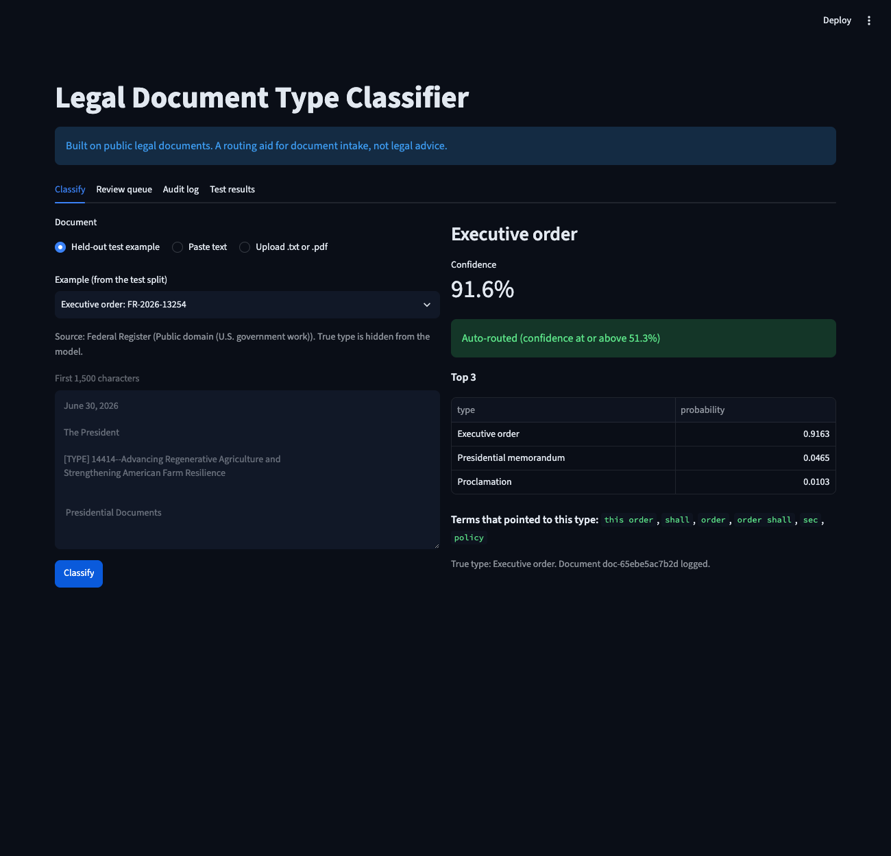
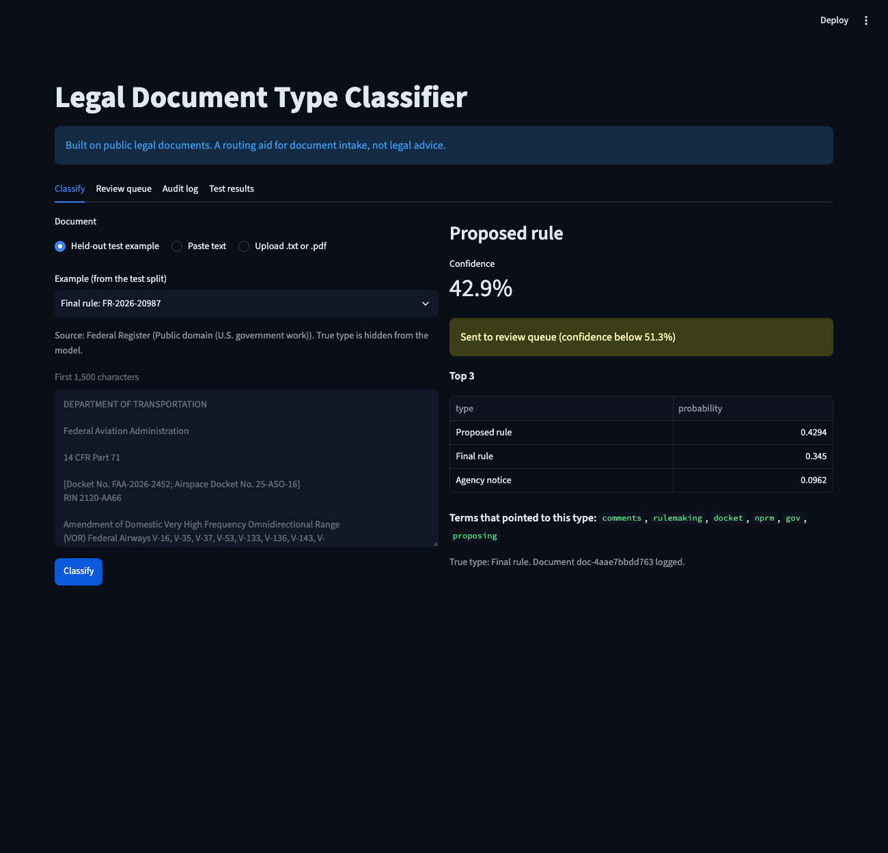
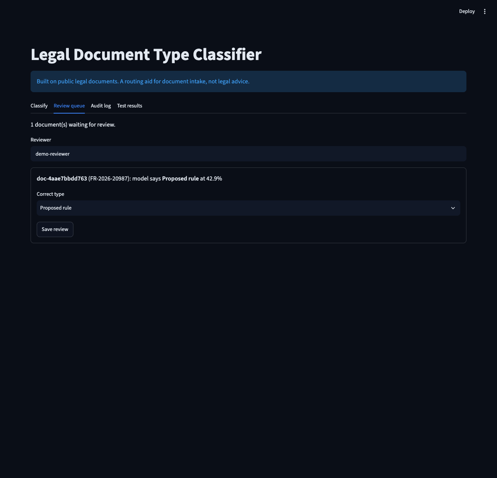
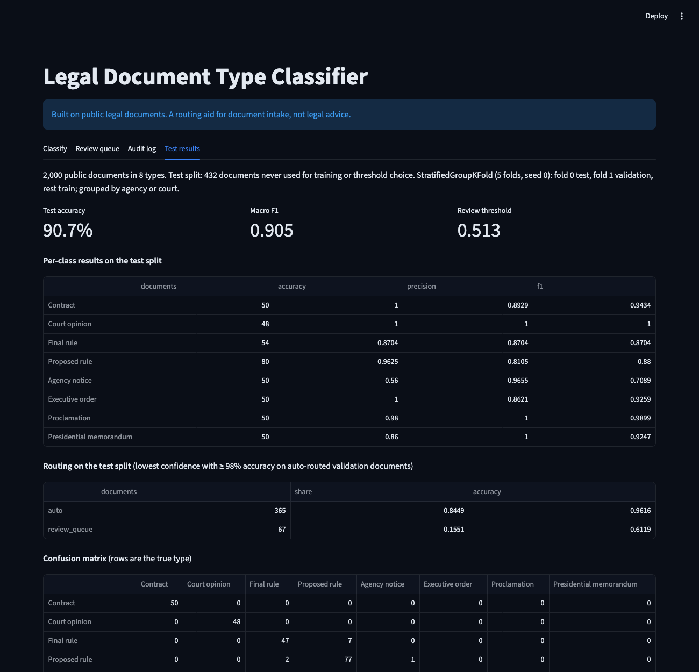
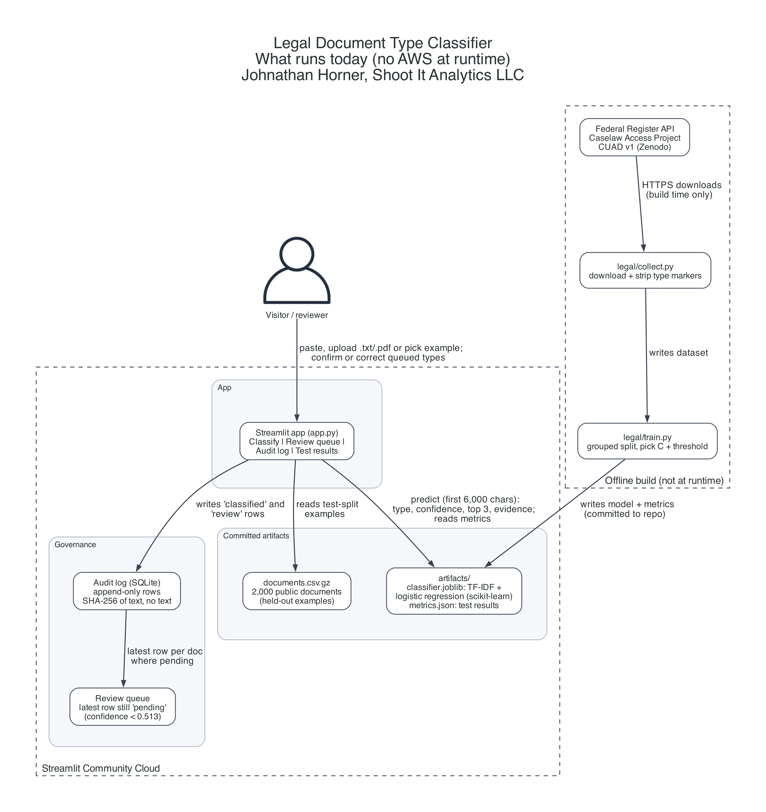

# Legal Document Type Classifier


**Status: Live.** Demo: https://legal-document-classifier.streamlit.app (checked 2026-11-16; the free
Streamlit host puts it to sleep when idle and it wakes on the first visit). The classifier, review
queue, audit log and Streamlit app also run locally.

Independent reference project by Shoot It Analytics LLC. Built with public or synthetic data.

## What it does

1. Reads a legal document (pasted text, a .txt file or the first 10 pages of a .pdf) and predicts its type out of 8:
   contract, court opinion, final rule, proposed rule, agency notice, executive order, proclamation,
   presidential memorandum.
2. Gives the prediction a confidence score and the three most likely types, and lists the words in
   the document that pushed it toward the predicted type.
3. Routes confident predictions to **auto** and low-confidence ones to a **review queue**, where a
   person confirms or corrects the type.
4. Logs every classification and every review to an append-only audit log. The log stores a SHA-256
   hash of the text, not the text itself.

| Auto-routed | Sent to review |
|---|---|
|  |  |

| Review queue | Test results |
|---|---|
|  |  |

## Case study

Built by Johnathan Horner, Shoot It Analytics LLC. The same case study is on the [portfolio](https://portfolio.johnathancloudspace.com/#legal-document-classifier).

### The problem

Legal and compliance teams sort incoming documents by type before anyone reads them for substance. It is slow, repetitive work, and a wrong label sends a document to the wrong queue.

### Why I built it

I wanted to see how far a small, cheap classifier trained on public documents could go, and whether its own confidence could separate the documents it gets right from the ones a person should check, measured on agencies and courts it never saw in training.

### Key decisions

1. **TF-IDF and logistic regression instead of an LLM.** It trains in 43 seconds on a laptop CPU, costs nothing per document and shows the terms behind each prediction. It is weaker on documents that differ only in meaning: agency notices are right 56% of the time.
2. **Strip the giveaways before training.** Headers and phrases that state the type outright are replaced with [TYPE], and tests check none remain. Scores are lower than on uncleaned text, but they measure substance, not headers.
3. **Hold out whole agencies and courts.** For rules, notices and opinions the split is grouped by agency or court, so templated documents from one source can't land in both train and test. Contracts and the three presidential types come from one source each, so they are split per document.
4. **Pick the review threshold on validation and use test once.** The threshold is the lowest confidence that gave 98% accuracy on auto-routed validation documents. On test the auto lane reached 96.2%, short of that target, and the README says so.

### Architecture

The diagram and the flow are in [Architecture](#architecture) below.

### Governance and safety

- Confidence routing: below 0.513 a document goes to a review queue where a person confirms or corrects the type.
- Append-only audit log of every classification and review, with a SHA-256 of the text and never the text itself (tested).
- Leakage guard: tests check no type-announcing text survives cleaning.
- Out-of-domain test: unrelated text (a recipe) must fall below the threshold.
- Labelled in the app as a routing aid for document intake, not legal advice; CI scans git history for secrets.

### Results

- 432 held-out documents: 90.7% accuracy, macro F1 0.905.
- Routing on test: 84.5% auto-routed at 96.2% accuracy; the 15.5% sent to review were right 61.2% of the time, which is why a person checks them.
- Per class: contracts, court opinions and executive orders 100%; agency notices 56%, the weakest class.
- 13 automated tests in CI.

### Limits

Built on public documents only (Federal Register, Caselaw Access Project, CUAD), 8 types, first 6,000 characters; not legal advice and not reviewed by any regulator.

### What I'd do in a real deployment

Train on the team's own intake types with reviewer corrections fed back as labels, compare against a small fine-tuned transformer, and run it behind sign-in with a durable audit store.

### Links

- Live app: https://legal-document-classifier.streamlit.app
- GitHub: https://github.com/johnathan-horner/legal-document-classifier
- Diagram: [docs/architecture/architecture.png](docs/architecture/architecture.png)

## Architecture



A person pastes text, uploads a .txt or .pdf, or picks a held-out example. The classifier reads the first 6,000 characters and returns a type, a confidence, the top 3 types and the terms behind the call; documents at 0.513 confidence or above go to auto, the rest to the review queue, and every step goes to an append-only SQLite log that stores a SHA-256 of the text. Data collection and training run offline and the model file is committed, so nothing calls out at runtime and no AWS is involved.

The diagrams are built with the Python `diagrams` library from [`docs/architecture/`](docs/architecture/). Each arrow is checked against the code and, for AWS calls, the AWS documentation; see [`docs/architecture/arrow-verification.md`](docs/architecture/arrow-verification.md). A 1200x1500 copy of each diagram (`*-linkedin.png`) is in the same folder.

| Piece | File |
|---|---|
| Data collection and cleaning | `legal/collect.py` -> `data/documents.csv.gz` |
| Classifier, routing, evidence terms | `legal/classifier.py` |
| Training and evaluation | `legal/train.py` -> `artifacts/metrics.json`, `artifacts/classifier.joblib` |
| Audit log | `legal/audit.py` |
| App | `app.py` |

The cleaned dataset (3 MB) and trained model are committed, so the app and tests run without
network access.

## How to run

Python 3.11.

```bash
python -m venv .venv && source .venv/bin/activate
pip install -r requirements-dev.txt
streamlit run app.py
pytest
```

Rebuild the dataset and retrain (downloads about 1,500 Federal Register documents, 6 Caselaw volumes
and the 106 MB CUAD archive; took about 40 minutes here, mostly downloads):

```bash
python -m legal.collect --per-class 250
python -m legal.train
```

## Measured results

**How measured.** `python -m legal.train`. 2,000 documents split with `StratifiedGroupKFold`
(5 folds, seed 0), grouped by agency (Federal Register rules and notices) or court (opinions): 1,161
train, 407 validation, 432 test. The regularization strength was picked on validation (C = 10,
91.7% validation accuracy), then the routing threshold on validation. The test split was used once.

Test split, per class:

| Type | Documents | Accuracy | Precision |
|---|---|---|---|
| Contract | 50 | 1.000 | 0.893 |
| Court opinion | 48 | 1.000 | 1.000 |
| Final rule | 54 | 0.870 | 0.870 |
| Proposed rule | 80 | 0.963 | 0.810 |
| Agency notice | 50 | 0.560 | 0.966 |
| Executive order | 50 | 1.000 | 0.862 |
| Proclamation | 50 | 0.980 | 1.000 |
| Presidential memorandum | 50 | 0.860 | 1.000 |
| **All** | **432** | **0.907** | macro F1 0.905 |

Routing on the test split (threshold 0.513):

| Lane | Documents | Share | Accuracy |
|---|---|---|---|
| Auto | 365 | 84.5% | 96.2% |
| Review queue | 67 | 15.5% | 61.2% |

The auto lane reached 96.2% on test against the 98% target set on validation.

Tests: 13 pytest tests (no type markers left in the data, licenses recorded, no agency or court in
two splits, the committed model reproduces the reported test accuracy, routing, the audit log stores
no text, and the Streamlit app). CI also runs ruff and scans the git history with gitleaks.

## Limits

- Contracts and court opinions come from different sources than the Federal Register documents, so
  part of their 100% accuracy comes from source style, not just content.
- Agency notices are the weak class (56%). Once their own "Notice" statements are removed, many read
  like rules, and a few (6 of 50) look like contracts.
- The classifier reads the first 6,000 characters of each document.
- Text only. Scanned PDFs need OCR first.
- No authentication in the app.

## What's next

- Add common intake types (letters, pleadings, motions) from public court records.
- Compare with a small fine-tuned transformer on the same split.

## Data and licenses

- Federal Register documents (federalregister.gov API): U.S. government works, public domain.
- Court opinions from the Caselaw Access Project (static.case.law, Federal Reporter 3d volumes
  500-600): public domain.
- Contracts from CUAD v1 by The Atticus Project (Zenodo record 4595826): CC BY 4.0.
- Each row in `data/documents.csv.gz` records its source, license and URL.


## License

Code: MIT, see [LICENSE](LICENSE). Data: see above.
